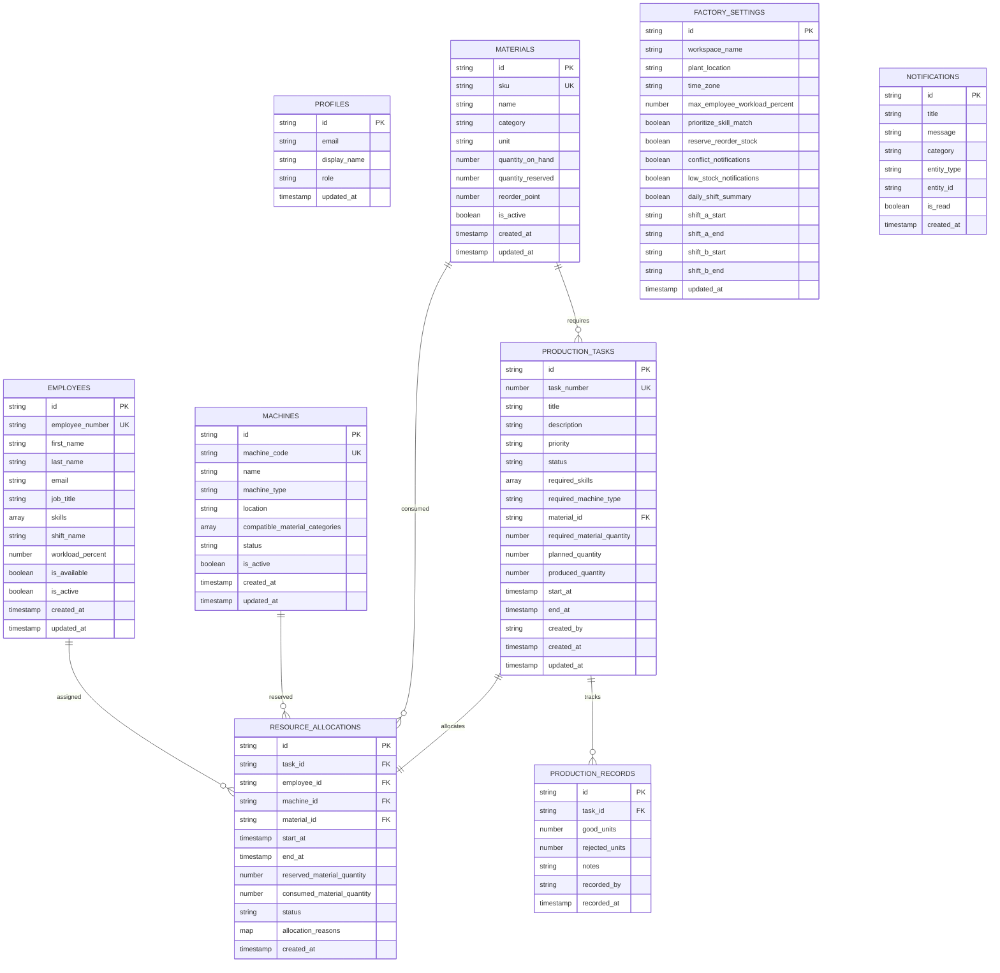

# Smart Factory Resource Allocation System (SRAS)
## Comprehensive College Project Report & Technical Specification

---

### 1. Abstract & Executive Summary
In modern manufacturing facilities, planning production jobs and allocating resources—such as qualified operators, specialized machines, and raw material inventory—is often performed manually using static spreadsheets or disconnected whiteboard schedules. This approach frequently causes three critical failure modes:
1. **Resource Conflicts & Double-Booking:** The same CNC machine or master technician is booked for overlapping tasks simultaneously.
2. **Operator Overburden & Skill Mismatches:** Workers are assigned jobs without proper skill certification, or their workload exceeds safety thresholds, resulting in quality defects and worker fatigue.
3. **Material Starvation:** Tasks are launched without verifying that sufficient stock is available above safety reorder buffers.

The **Smart Factory Resource Allocation System (SRAS)** resolves these challenges by providing an intelligent, web-based operations platform backed by Google Cloud Firestore and Firebase. It evaluates multi-constraint feasibility rules in real time, selects optimal operator-machine pairings via a workload-balancing heuristic, and commits allocations inside atomic database transactions.

---

### 2. Problem Statement & Project Objectives

#### 2.1 Problem Statement
"To develop an intelligent, cloud-connected factory operations system that automates the assignment of employees, machines, and materials for planned production runs, eliminates scheduling conflicts, protects inventory buffers, and provides transparent audit trails for factory administrators."

#### 2.2 Core Objectives
- **Automated Resource Allocation:** Replace manual guesswork with algorithmic matching that checks skills, machine types, material categories, and temporal availability.
- **Zero Temporal Conflicts:** Mathematically enforce that no technician or equipment can be booked for intersecting time windows.
- **Workload Balancing:** Minimize operator fatigue by preferentially selecting available technicians with the lowest workload percentage among qualified candidates.
- **Inventory Buffer Protection:** Prevent inventory stockouts by ensuring required quantities do not consume safety reorder reserves.
- **Role-Based Access Control (RBAC):** Protect operational configurations and data mutations behind verified factory administrator privileges enforced in Firestore Security Rules and Cloud Functions.
- **Comprehensive Auditability:** Maintain append-only production logs and structured allocation decision rationales.

---

### 3. System Architecture & Technology Stack

#### 3.1 Architectural Overview
The system follows a modern **Cloud-Native Decoupled Architecture**:

```
+-------------------------------------------------------------------------+
|                         PRESENTATION TIER (UI)                          |
|  React 19 + Vite 7 + Tailwind CSS v4 + Lucide Icons + Responsive SPA    |
|  - Real-Time Smart Allocation Simulator & Conflict Inspector            |
|  - Visual Gantt Timeline, Production Pulse & Analytics Dashboard        |
+-----------------------------------+-------------------------------------+
                                    |
                    HTTPS / Firebase SDK v13 (Modular)
                                    |
+-----------------------------------v-------------------------------------+
|                      APPLICATION / LOGIC TIER                           |
|  Cloud Functions for Firebase (v2, Node.js 20)                          |
|  - Strict Input Sanitization, Range Clamping, and UUID Verification    |
|  - Multi-Constraint Heuristic Matching Engine                           |
|  - Dual-Mode Client Fallback (Guarantees operation on Spark free tier)  |
+-----------------------------------+-------------------------------------+
                                    |
                    Google Cloud Firestore (Enterprise Mode)
                                    |
+-----------------------------------v-------------------------------------+
|                          DATA & SECURITY TIER                           |
|  Google Cloud Firestore + Firebase Authentication (Email/Password)      |
|  - Least-Privilege Security Rules (Strict Privilege Escalation Locks)   |
|  - ACID Transactions (runTransaction) with Zero Race Conditions         |
+-------------------------------------------------------------------------+
```

#### 3.2 Technology Stack
| Layer | Technology | Version | Purpose |
| :--- | :--- | :--- | :--- |
| **Frontend Framework** | React | 19.1.0 | Component-based reactive UI |
| **Build Tool & Bundler**| Vite | 7.3.7 | Fast HMR and optimized production bundling |
| **Styling** | Tailwind CSS + Custom CSS | 4.1.13 | High-fidelity dark/light modern UI |
| **Icons** | Lucide React | 0.468.0 | Consistent iconography |
| **Database** | Google Cloud Firestore | Latest | Document-oriented real-time cloud database |
| **Authentication** | Firebase Authentication | Latest | Secure email/password auth with Custom Claims |
| **Serverless Logic** | Cloud Functions for Firebase | v2 (Node 20) | Transactional server-side execution |
| **Admin Utilities** | Firebase Admin SDK | 13.5.0 | Secure provisioning and CLI seeding |

---

### 4. Smart Allocation Algorithm & Mathematical Formulation

The allocation engine processes each task request through four sequential phases:

#### Phase 1: Hard Constraint Feasibility Check
A candidate operator $e \in \mathcal{E}$, machine $m \in \mathcal{M}$, and material $mat \in \mathcal{R}$ must satisfy:
1. **Operator Availability & Capability:**
   $$\text{Active}(e) = \text{true} \land \text{Available}(e) = \text{true} \land \text{Skills}(e) \supseteq \mathcal{S}_{\text{required}}$$
2. **Machine Suitability:**
   $$\text{Active}(m) = \text{true} \land \text{Status}(m) = \text{"available"} \land \text{Type}(m) = \mathcal{T}_{\text{required}} \land \text{Category}(mat) \in \text{Compatible}(m)$$
3. **Inventory Availability with Safety Buffer:**
   $$Q_{\text{on\_hand}}(mat) - Q_{\text{reserved}}(mat) - (\text{ReserveBuffer} \times Q_{\text{reorder}}(mat)) \ge Q_{\text{required}}$$

#### Phase 2: Temporal Conflict Detection (Zero Overlap)
Let $[t_s, t_e]$ represent the requested task time interval. A resource $r \in \{e, m\}$ is free if and only if:
$$\forall a \in \text{Allocations}(r) \text{ where } \text{Status}(a) \in \{\text{"reserved"}, \text{"in\_progress}\}\!:$$
$$(t_s \ge \text{End}(a)) \lor (t_e \le \text{Start}(a))$$
Any resource failing this condition is excluded from consideration.

#### Phase 3: Multi-Objective Load Balancing
Among all qualified, conflict-free operators, the system selects the optimal operator $e^*$ that minimizes current workload percentage:
$$e^* = \arg\min_{e \in \mathcal{E}_{\text{feasible}}} \text{WorkloadPercent}(e)$$
Subject to:
$$\text{WorkloadPercent}(e) \le W_{\max} \quad (\text{Default: } 85\%)$$
This balances shifts evenly, prevents burnout, and ensures higher quality output.

#### Phase 4: Atomic ACID Transactional Commit
All operations are executed inside `runTransaction`:
- Task counter is incremented.
- `production_tasks` document created (`status: 'scheduled'`).
- `resource_allocations` document created containing structured `allocation_reasons`.
- `materials.quantity_reserved` incremented by $Q_{\text{required}}$, locking inventory immediately.
- `employees.last_allocated_at` and `machines.last_allocated_at` updated.
- Audit notification created in `notifications`.

---

### 5. Cloud Firestore Database Schema (9 Collections)



---

### 6. Security & Authorization Model

1. **Role Enforcement at Database Layer:**
   - Client direct writes to factory collections are strictly restricted to authenticated administrators (`isAdmin()`).
   - Normal authenticated users (Operators) can read inventory and task schedules, but any attempt to forge tasks, alter allocations, or tamper with settings is rejected at the Firestore Rules layer.
2. **Prevention of Self-Escalation:**
   - In `firestore.rules`, `/profiles/{userId}` explicitly prevents standard users from setting `role: "admin"` on profile creation or update:
   ```firestore
   allow update: if signedIn() && (
     (request.auth.uid == userId && (
       (!('role' in request.resource.data) || request.resource.data.role == resource.data.role) &&
       request.resource.data.role != "admin"
     )) ||
     isAdmin()
   );
   ```
3. **No Hard-Coded Credentials:**
   - Production secrets and private keys are never committed into repository files.
   - Frontend configuration relies solely on public client keys defined in `frontend/.env`.

---

### 7. Core Application Modules & User Workflow

1. **Authentication & Session Verification:**
   - Secure sign-in verifies Firebase auth and Firestore profile.
   - Operators without admin claims receive a clear, informative restricted-view banner.
2. **Overview Dashboard:**
   - Executive KPIs: Open Tasks, Available Workforce, Ready Equipment, Inventory Health.
   - Production pulse bar chart and recent notification alerts.
3. **Production Task Management:**
   - Create, edit, start, log output, and cancel production runs.
   - Interactive live smart allocation preview during task creation shows matching candidates and warns of conflicts in real time.
4. **Resources Catalog:**
   - Manage Employees, Machines, and Materials with strict unique SKU/ID checks.
5. **Schedule & Timeline:**
   - Visual Gantt timeline displaying task bars across time windows.
   - Zero-overlap verification and allocation breakdown rationales.
6. **Analytics & Quality Metrics:**
   - First-pass production yield rate %, defect/scrap volume, and machine readiness index.
7. **Settings & Demo Data Seeder:**
   - Configurable shifts, workload limits, and one-click demo data provisioning.

---

### 8. Project Limitations & Future Scope

#### Current Limitations
- Single-plant scope: Focuses on one primary factory facility per workspace document.
- Fixed shift model: Currently optimized for two standard 8-hour working shifts (Shift A and Shift B).
- Linear material consumption: Raw material consumption is calculated proportionally to units produced.

#### Future Enhancements
1. **IoT Machine Sensor Integration:** Connect MQTT brokers directly to machines to automatically update status (`in_use`, `maintenance`, `idle`) from physical sensors.
2. **Predictive Maintenance Scheduling:** Use machine learning models to predict tool wear and automatically schedule maintenance before breakdowns occur.
3. **Automated Purchase Order Generation:** Trigger automated webhook orders to suppliers when inventory drops below critical reorder points.

---
*Report prepared for Smart Factory Resource Allocation System (SRAS) College Viva & Project Evaluation.*
